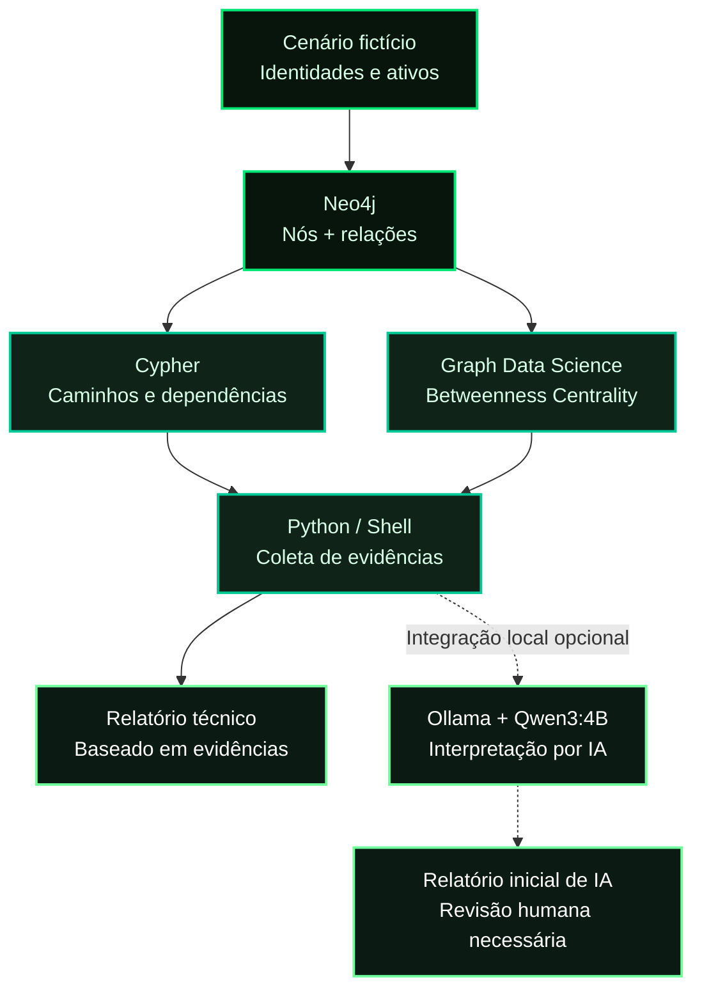
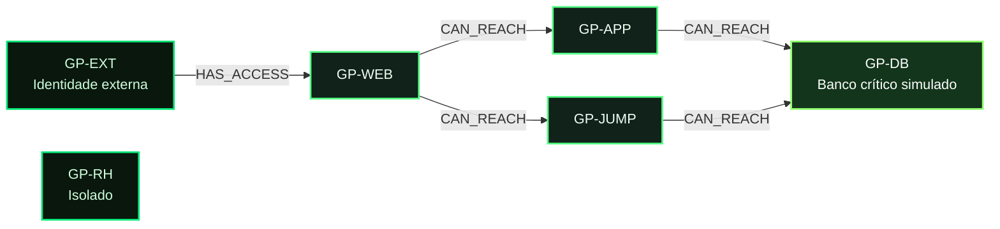

<div align="center">


<br />

**GRAPH INTELLIGENCE · CYBERSECURITY ANALYTICS · LOCAL GENERATIVE AI**


**[Visão geral](#visao-geral) · [Arquitetura](#arquitetura) · [Resultados](#resultados) · [Executar](#executar) · [Roadmap](#roadmap)**

</div>

---

<a id="visao-geral"></a>

## `>_` Visão geral

O **GraphPath AI** é um laboratório de **análise de conectividade e dependências de segurança baseado em grafos**. Ele combina a modelagem de ativos no **Neo4j**, consultas **Cypher**, algoritmos de **Graph Data Science (GDS)** e interpretação de evidências com **IA generativa local (Ollama + Qwen)**.

> [!IMPORTANT]
> **Cenário 100% fictício.** As rotas representam **possibilidades de conectividade modeladas**, e não ataques confirmados. Uma pontuação de centralidade elevada, isoladamente, **não comprova vulnerabilidade ou risco**.

### O que este MVP demonstra

| Módulo | Capacidade implementada | Situação |
| :--- | :--- | :---: |
| `01 / GRAPH` | Modelagem de identidades, ativos e relacionamentos | ✅ |
| `02 / CYPHER` | Descoberta de caminhos até um ativo crítico simulado | ✅ |
| `03 / GDS` | **Betweenness Centrality** por nó | ✅ |
| `04 / IMPACT` | Simulação não destrutiva da ausência de um nó | ✅ |
| `05 / AI` | Relatório inicial interpretado pelo Qwen local | ✅ |
| `06 / QA` | Coleta reproduzível e **6 testes de consistência** | ✅ |

<a id="arquitetura"></a>

## `>_` Arquitetura



### Tecnologias

`Python` · `Neo4j` · `Cypher` · `Graph Data Science` · `Docker Compose` · `Bash` · `Ollama` · `Qwen3:4B-Instruct` · `unittest`

A análise de grafos funciona sem executar a IA. A geração com Qwen foi validada em **Windows + WSL2** e segue como módulo opcional, dependente de uma instalação local do Ollama.

<a id="resultados"></a>

## `>_` Resultados do laboratório

O cenário inicial possui **6 nós** e **5 relacionamentos**. Uma identidade externa (`GP-EXT`) dispõe de dois caminhos modelados até o banco de dados (`GP-DB`):



**Rotas obtidas por Cypher:**

```text
[1] GP-EXT → GP-WEB → GP-APP  → GP-DB
[2] GP-EXT → GP-WEB → GP-JUMP → GP-DB
```

### Centralidade estrutural (GDS)

| Ativo | Betweenness Centrality |
| :--- | ---: |
| **GP-WEB** | **3.0** |
| GP-APP | 1.0 |
| GP-JUMP | 1.0 |
| GP-DB | 0.0 |
| GP-EXT | 0.0 |
| GP-RH | 0.0 |

### Simulação de dependência

```text
$ ANÁLISE DE CAMINHOS
  Caminhos identificados ................. 2
  Caminhos excluindo GP-WEB .............. 0
  Alterações no banco .................... nenhuma
  Interpretação .......................... ponto de passagem obrigatório
```

**Leitura técnica:** no grafo construído, `GP-WEB` pertence aos dois caminhos observados entre `GP-EXT` e `GP-DB`. O teste desconsidera esse nó **somente na consulta**, sem removê-lo do Neo4j. Esses resultados não demonstram comprometimento, indisponibilidade real ou possibilidade de exploração.

<a id="executar"></a>

## `>_` Execução local

### Pré-requisitos

- Docker e Docker Compose acessíveis no terminal Linux/WSL2;
- Python **3.10+**;
- Git;
- Ollama e `qwen3:4b-instruct` **somente se desejar testar a IA**.

**1. Clonar e configurar**

```bash
git clone https://github.com/Paula-Tech007/graphpath-ai.git
cd graphpath-ai
cp .env.example .env
```

Edite `.env` e substitua o valor de `NEO4J_PASSWORD` por uma senha forte **antes da primeira inicialização**. O arquivo `.env` é ignorado pelo Git.

**2. Preparar o laboratório**

```bash
./scripts/preparar_laboratorio.sh
```

O script inicia o Neo4j, aguarda o banco ficar disponível, carrega os dados fictícios e prepara a projeção GDS. A projeção fica em memória e pode precisar ser recriada após reinícios.

**3. Coletar evidências e gerar o relatório técnico**

```bash
./scripts/coletar_evidencias.sh
```

Esse comando atualiza `evidencias.txt`, gera `relatorio_tecnico.md` e executa os testes de consistência.

**4. Verificar a integração**

```bash
./scripts/verificar_integracao.sh
python3 -m unittest discover -s tests -v
```

<details>
<summary><strong>Exemplo do resultado esperado dos testes</strong></summary>

```text
Ran 6 tests

OK
```

Esses testes conferem as evidências salvas do cenário inicial. Não são uma suíte completa de testes ponta a ponta.

</details>

### Acesso ao Neo4j Browser

- URL local: **http://localhost:7474**
- Usuário: `neo4j`
- Senha: a definida em `.env` na primeira inicialização.

> [!CAUTION]
> Alterar `.env` depois que o volume do Neo4j já foi inicializado **não modifica automaticamente** a senha armazenada no banco. Não publique `.env`, tokens ou dados de ambientes reais.

## `>_` Inteligência artificial local

O projeto inclui uma experiência de geração de relatório com **Ollama + Qwen3:4B-Instruct**. O modelo recebeu as evidências coletadas e produziu uma interpretação inicial em português.

- `integrar_ia.py`: primeira integração experimental;
- `gerar_relatorio_limitado.py`: versão com limite de geração e tempo máximo;
- `consolidar_relatorio.py`: consolidação técnica **determinística**, sem depender do modelo generativo.

**Limitação atual:** os scripts de IA usam o PowerShell do Windows a partir do WSL2. A integração com IA não é necessária para executar os testes principais. Saídas geradas por LLM devem passar por revisão técnica e **não devem ser tratadas como evidência adicional**.

## `>_` Estrutura do repositório

```text
graphpath-ai/
├── assets/
│   └── graphpath-matrix.png       # Banner oficial (imagem original)
├── scripts/
│   ├── preparar_laboratorio.sh    # Inicialização Neo4j + GDS
│   ├── coletar_evidencias.sh      # Coleta, relatório e testes
│   └── verificar_integracao.sh   # Verificações de funcionamento
├── tests/
│   └── test_graphpath.py         # 6 testes de consistência
├── compose.yaml                  # Neo4j em Docker
├── seed.cypher                   # Grafo fictício
├── gds.cypher                    # Projeção e centralidade
├── impacto.cypher                # Simulação não destrutiva
├── integrar_ia.py                # Integração experimental com IA
├── gerar_relatorio_limitado.py   # Geração limitada via Ollama
├── consolidar_relatorio.py      # Relatório técnico consolidado
├── evidencias.txt                # Saída de referência
├── relatorio_tecnico.md          # Relatório verificável
├── .env.example                  # Modelo sem credenciais
└── README.md
```

<a id="roadmap"></a>

## `>_` Roadmap

- [x] Modelagem de ativos e caminhos com Neo4j/Cypher
- [x] Centralidade com GDS e simulação de impacto
- [x] Integração experimental com IA local
- [x] Relatório baseado em evidências e 6 testes
- [ ] Testes de integração de ponta a ponta
- [ ] Integração Ollama portável entre sistemas
- [ ] Embeddings e busca semântica (GraphRAG)
- [ ] API Python e interface interativa de grafos
- [ ] Cenários ampliados com dados fictícios

## `>_` Escopo e responsabilidade

Este é um **projeto de estudo e portfólio**, executado sobre ativos simulados. Não coleta dados de clientes, não realiza exploração ofensiva e não atribui automaticamente risco a ativos com alta centralidade. As recomendações derivadas dos resultados são hipóteses para avaliação, não constatações de falhas reais.

**Licença:** ainda não definida. Até que uma licença seja adicionada, o repositório público não concede automaticamente permissões amplas de reutilização.

---

<div align="center">

**`[ GRAPH ANALYSIS COMPLETE ]`**

<sub>Desenvolvido para demonstrar análise de segurança com grafos, automação e IA local.</sub>

<sub>Projeto por <a href="https://github.com/Paula-Tech007">Paula-Tech007</a> · MVP em evolução contínua</sub>

</div>
